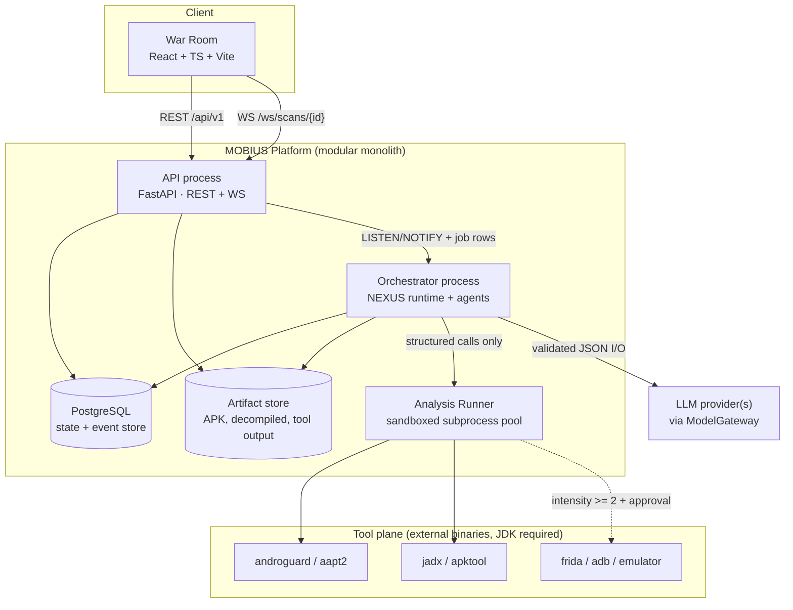
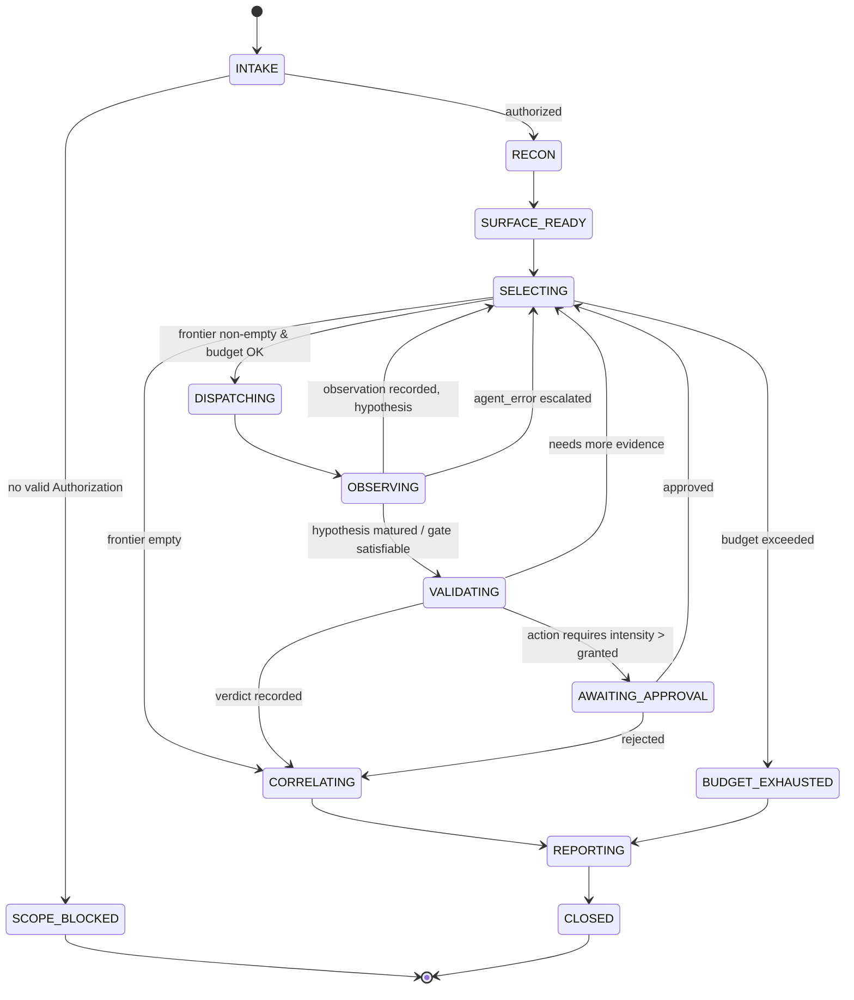
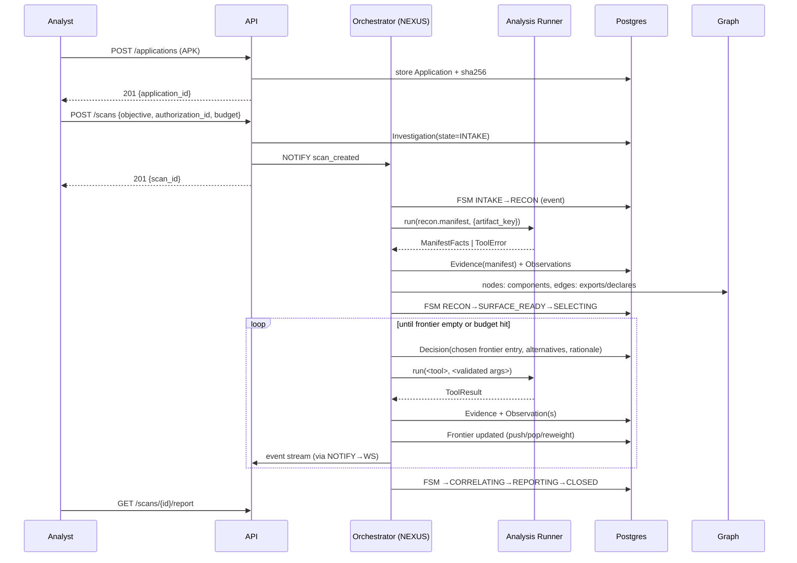

# SYSTEM ARCHITECTURE

**Status:** Proposed — requires Project Director approval before implementation
**Supersedes:** nothing (greenfield)
**Decisions referenced:** `ARCHITECTURE_DECISIONS.md`

---

## 1. Architectural drivers

Ranked, because when they conflict the higher one wins:

| # | Driver | Consequence |
|---|---|---|
| D1 | **Auditability.** Any finding must be reconstructable from stored data. | Append-only event log is a first-class component, not logging. |
| D2 | **Untrusted input.** APKs are hostile; decompilers are C/Java parsers with real CVEs. | Analysis runs out-of-process, unprivileged, network-isolated. |
| D3 | **Bounded autonomy.** An agent loop that can run unbounded is a liability. | Explicit FSM + budgets + circuit breakers. |
| D4 | **6-person, limited Android experience.** | One language per tier, strict schema contracts, interfaces frozen early. |
| D5 | **Graceful degradation.** Tools will be missing, crash, or time out. | Every adapter optional; absence is a first-class state. |
| D6 | **Demonstrable in one semester.** | Vertical slice over horizontal breadth. |

## 2. System context



**Why three processes and not one:** the API must stay responsive while a 3-minute JADX run churns;
the runner must be killable without killing the orchestrator; the orchestrator must not import
analysis libraries (D2). This is a *modular monolith* in the sense that it is one codebase, one
schema, one deployable image with three entrypoints — not three independently versioned services.

## 3. The four layers

### 3.1 Layer 1 — Domain core (`mobius/core`)

Pure Python, no I/O, no framework imports. Contains:

- Pydantic models: `Application`, `Investigation`, `Observation`, `Hypothesis`, `Finding`,
  `Evidence`, `Decision`, `AgentTask`, `GraphNode`, `GraphEdge`, `Authorization`.
- The investigation FSM (§4).
- The frontier scorer.
- The confirmation-gate predicates.
- Invariants (e.g. "a CONFIRMED finding has ≥ 1 satisfying gate").

**Testability rule:** the domain core reaches ≥ 90% line coverage and contains zero `import
fastapi`, `import sqlalchemy`, `import httpx`. Enforced by an import-lint test. This is the single
most valuable structural decision for a 6-person team: the interesting logic is testable without a
database, a model, or a JVM.

### 3.2 Layer 2 — Adapters (`mobius/adapters`)

- `db/` — SQLAlchemy repositories, one per aggregate. No ORM objects leak to Layer 1.
- `llm/` — `ModelGateway` interface with structured-output enforcement and a repair loop.
- `tools/` — one module per external tool, each implementing `ToolAdapter`.
- `storage/` — content-addressed artifact store (local FS for dev, S3-compatible for deployment).
- `events/` — event append + pub/sub bridge.

### 3.3 Layer 3 — Application services (`mobius/services`)

Use cases: `IntakeService`, `InvestigationService`, `ReconService`, `CodeService`,
`ValidationService`, `GraphService`, `ReportService`. Each is a thin orchestration of Layer 1 + 2.

### 3.4 Layer 4 — Delivery (`mobius/api`, `mobius/worker`)

FastAPI routers and the worker's task loop. Contains no business logic that Layer 1 could hold.

## 4. The investigation state machine

This is the most important diagram in the project. The master prompt describes a "conceptual
workflow, not a mandatory linear pipeline" — the way to honour that is a **state machine whose
transitions are guarded, combined with a worklist (frontier) inside the investigation state.**



Properties that make this defensible:

1. **Every transition is an event.** `investigation_updated` with `from`/`to`. There is no path that
   mutates state without an event (NFR-AUD-1).
2. **The FSM is code, not a prompt.** `NEXUS` does not decide *whether* to validate; the FSM decides
   when validation is *possible*, and NEXUS decides *which* validation. This split is the core
   insight: **control flow is deterministic, content is model-driven.** Research supports this —
   unconstrained ReAct loops fail on retry storms, context snowball, and lack of rollback, while
   state-machine control gives deterministic safety guarantees [S1][S2][S3].
3. **`BUDGET_EXHAUSTED` is a legal terminal state**, not an error. Half-finished investigations are
   normal and must be reported honestly.

### 4.1 Where autonomy actually lives

Autonomy is confined to two decisions, both inside `SELECTING`:

- **Which frontier entry to pop** (ranking).
- **Parameterising the chosen action** (e.g. which class to look at, which intent to send).

Everything else — transitions, budgets, gates, tool availability, sandbox policy — is deterministic
code. If a graduation panel asks "is this really autonomous?", the honest answer is: *it is
autonomous within a bounded, auditable action space*, and that constraint is what makes it safe.

## 5. Data flow for one investigation



## 6. Trust boundaries

| Boundary | Crossing | Control |
|---|---|---|
| B1 Browser ↔ API | User input, JSON | AuthN, schema validation, size limits, no HTML rendering of tool output |
| B2 API ↔ Worker | Job rows + NOTIFY | Shared DB, same trust domain, but worker holds no session secrets |
| B3 Worker ↔ Runner | Validated argv + JSON payload | **Hard boundary.** Runner has no DB credentials, no outbound net, no filesystem write outside its scratch dir |
| B4 Runner ↔ Target APK | Decompiler parsing hostile bytes | Unprivileged UID, `no-new-privileges`, memory cap, wall-clock kill, read-only input mount |
| B5 Runner ↔ Target device/emulator | Dynamic instrumentation | Intensity gate + approval + isolated network segment |
| B6 Worker ↔ LLM provider | **APK content leaves the machine** | Explicit consent, redaction of secrets, provider allowlist; documented in `THREAT_MODEL.md` T-07 |

**B6 deserves emphasis.** Sending decompiled proprietary code to a third-party model is a real data
protection issue that most agent demos ignore. MOBIUS must make it visible: the scan config records
`llm_data_sharing: {enabled, provider, redaction_rules}` and the UI shows a badge when enabled.

## 7. Deployment topology

### 7.1 Development (works in this sandbox)

```
api (uvicorn) ──┐
worker ─────────┼── Postgres (managed or local) ── local artifact dir
runner ─────────┘                                 (androguard only; no JDK)
frontend (vite dev server, proxy → api)
```

### 7.2 Analysis host (JDK + KVM required — not this sandbox)

Same code, plus: JDK 17, Android SDK build-tools (aapt2), jadx, apktool, and for PHANTOM an
emulator AVD or Redroid container. Configured via `MOBIUS_TOOL_PATHS`; missing tools are reported as
`tool_unavailable` rather than crashing (NFR-PORT-1).

### 7.3 What is deliberately absent

No Kubernetes, no message broker, no service mesh, no graph database, no vector store, no
Celery/Redis broker, no microservice split. Each was considered and rejected with a stated reason in
`ARCHITECTURE_DECISIONS.md`. For a 6-person semester project these are cost with no corresponding
benefit.

## 8. Vertical slice v1 — the recommended first milestone

The master prompt's Phase 2–9 is a 12-phase waterfall. For a semester that is unachievable at
quality. The recommended slice delivers *one complete, honest investigation path*:

```
Upload → Authorize → RECON (androguard) → NEXUS picks 2–3 targeted code checks
       → SPECTRE (jadx on ONE class) → VERITAS gate → Evidence → Graph (10–30 nodes)
       → War Room live feed → Markdown/PDF report
```

Deliberately excluded from v1: PHANTOM, VECTOR, ORACLE, multi-agent parallelism, model routing,
attack-path scoring. Included and non-negotiable: audit trail, confirmation gates, honest empty
states, evidence referential integrity.

**Rationale:** a panel can forgive missing dynamic analysis. It cannot forgive a system that
displays confidence it has not earned. The slice is chosen so that everything displayed is real.

## 9. Technology choices and the alternatives not taken

| Layer | Chosen | Rejected alternative | Why |
|---|---|---|---|
| API | FastAPI + Pydantic v2 | Django | Pydantic-native schemas shared with the agent layer; async fits WS |
| DB | PostgreSQL | MongoDB | Relational integrity matters for evidence→finding→decision chains; JSONB covers semi-structured |
| Graph | Adjacency tables + recursive CTE | Neo4j | Expected ≤ ~5k nodes/scan; Cypher adds a service and a second query language (ADR-006) |
| Job execution | Postgres queue + `FOR UPDATE SKIP LOCKED` | Celery/Redis | One less service; SKIP LOCKED is sufficient and transactional (ADR-007) |
| Events | Append table + `LISTEN/NOTIFY` | Kafka/Redis pub/sub | Durability is required, throughput is not |
| Frontend | React + TS + Vite | Next.js | No SSR need; static build is simpler to serve |
| Graph UI | React Flow | Cytoscape / D3 | Built-in node/edge interaction, custom node renderers, well-documented; Cytoscape is better for huge graphs, which we bound away from |
| Code view | Monaco | CodeMirror 6 | Multi-language, decorations API for evidence highlights, familiar |
| Styling | Tailwind + CSS variables for the design tokens | component library | A "premium cyber command centre" look is defeated by generic component defaults |
| Orchestration | Hand-rolled FSM | LangGraph | Full control of persistence and audit; LangGraph would own the state model and complicate the event log (ADR-011) |
| Sandbox | Docker + `nsjail`/`firejail`; fallback `setrlimit` + unprivileged UID | gVisor / microVM | Stronger isolation is real but operationally heavy for a laptop demo |

## 10. Open architecture questions

| # | Question | Needs |
|---|---|---|
| Q1 | Where do analysis workers run (JDK/KVM)? | Director decision — blocks Phase 3 execution |
| Q2 | Is a managed Postgres available, or must the schema stay SQLite-compatible for dev? | Infra answer — affects migration strategy |
| Q3 | Is sending decompiled code to a hosted LLM acceptable for the lab's APKs? | Ethics/policy answer — affects B6 design |
| Q4 | Which 2–3 benign apps serve as the negative control? | Team choice — blocks false-positive claims |

---

## Sources

- [S1] ReAct (Yao et al., 2022/2023) — interleaved reasoning/acting; the baseline being constrained.
- [S2] Plan-and-Execute (LangChain, 2023) — planning/execution separation; basis for the deterministic-plan + bounded-execution split.
- [S3] "Agentic Loops & State Machine Design: From ReAct to Deterministic Control Flows" — enumerated production failure modes of raw ReAct (retry storms, context snowball, dirty state, no rollback): https://blog.llmgo.top/en/articles/agent-loop-state-machine/
- [S4] OWASP MASVS v2.1.0 / MASTG v2.0.0 / MASWE v1.0.0 — https://mas.owasp.org / https://github.com/OWASP/masvs/releases
