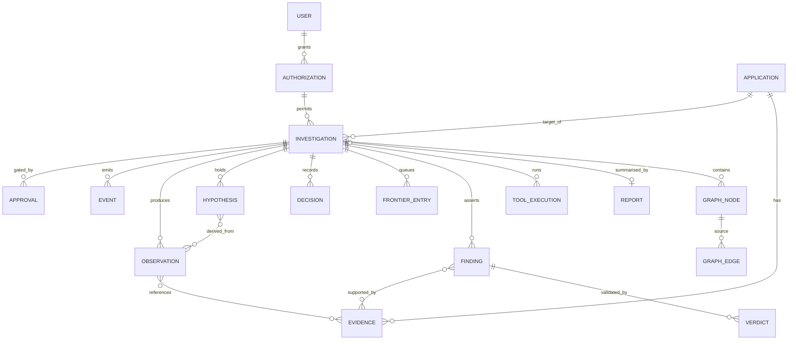

# DATABASE SCHEMA

**Status:** Proposed
**Target:** PostgreSQL 16
**Portability:** avoids Postgres-only constructs except `JSONB`, `LISTEN/NOTIFY`, and `FOR UPDATE SKIP LOCKED` — see §7 for the SQLite dev fallback.

---

## 1. Design principles

1. **Append-only where audit matters.** Events, evidence and decisions are insert-only. No `UPDATE` on
   an event. Corrections are new events referencing the old one.
2. **Immutable identity.** An `Application` is identified by its SHA-256. Re-uploading the same bytes
   is not a new application.
3. **Separation of fact and belief.** `observations` (seen) vs `hypotheses` (believed) vs `findings`
   (asserted, validated) are three tables, not one polymorphic "result" table.
4. **Evidence is content-addressed.** `evidence.sha256` is unique per scan; identical blobs dedupe.
5. **Nothing important is stored only in memory.** The frontier, FSM state and budgets are all rows
   (FR-NEXUS-7).
6. **No soft-delete on findings.** `REJECTED` is a status, not a deletion (FR-VER-5).

## 2. Entity map



## 2.1 Entities named in the brief that are deliberately not tables

The brief's §13 entity list is a starting proposal. Four of its entities are not tables here; each
omission is a decision, not an oversight, and is recorded so the mapping is auditable.

| Brief entity | Status here | Why |
|---|---|---|
| `Agents` | **No table** | Agents are code (`ADR-004`), not rows. Their *state* is derived from `events`, which is the only source the War Room must trust (`EVENT_ARCHITECTURE.md §8`). A mutable `agents` table would be a second source of truth that can drift from the event log. |
| `AgentTasks` | → `frontier_entries` | Renamed: the unit of work is a frontier entry with a score, a lease and attempts — a task queue, not a task record. |
| `AgentMessages` | **Removed** (`ADR-004`) | Agents are functions invoked by a scheduler; there is no peer-to-peer channel. Inter-agent exchange is `decision_made` + `observation_created` linked by `correlation_id`. See `EVENT_ARCHITECTURE.md §4` "Retired". |
| `CodeReferences` | → folded into `observations` | A code reference is provenance on an observation (`subject_ref` + `source_ref`), not an independent entity. A separate table would allow a reference to exist with no claim attached to it — precisely the "evidence without a finding" clutter this project avoids. |
| `ModelConfigurations` / `ModelEvaluations` | **Not in v1** | Routing is two environment variables and two tiers (`ADR-010`). Persisting model configuration is meaningful only once several models are benchmarked, at which point `MODEL_BENCHMARKS.md` results — not a DB table — are the artefact that matters. Deferred, not forgotten. |

## 3. Tables

### 3.1 Identity & authorisation

```sql
CREATE TABLE users (
    id            uuid PRIMARY KEY DEFAULT gen_random_uuid(),
    email         citext UNIQUE NOT NULL,
    display_name  text NOT NULL,
    role          text NOT NULL CHECK (role IN ('analyst','reviewer','admin')),
    password_hash text NOT NULL,           -- argon2id
    created_at    timestamptz NOT NULL DEFAULT now()
);

CREATE TABLE authorizations (
    id             uuid PRIMARY KEY DEFAULT gen_random_uuid(),
    granted_by     uuid NOT NULL REFERENCES users(id),
    target_package text NOT NULL,
    apk_sha256     char(64) NOT NULL,      -- pinned; FR-AUTH-3
    scope_text     text NOT NULL CHECK (length(scope_text) >= 20),
    max_intensity  smallint NOT NULL CHECK (max_intensity BETWEEN 0 AND 3),
    statement      text NOT NULL,          -- signed assertion of ownership/permission
    expires_at     timestamptz NOT NULL,
    revoked_at     timestamptz,
    created_at     timestamptz NOT NULL DEFAULT now(),
    CONSTRAINT authorization_expiry_sane CHECK (expires_at > created_at)
);
CREATE INDEX ON authorizations (apk_sha256) WHERE revoked_at IS NULL;
```

### 3.2 Applications & investigations

```sql
CREATE TABLE applications (
    id             uuid PRIMARY KEY DEFAULT gen_random_uuid(),
    sha256         char(64) UNIQUE NOT NULL,
    package_name   text,
    version_name   text,
    version_code   bigint,
    min_sdk        smallint,
    target_sdk     smallint,
    file_size      bigint NOT NULL,
    artifact_key   text NOT NULL,          -- object-store key; NEVER a repo path
    uploaded_by    uuid REFERENCES users(id),
    created_at     timestamptz NOT NULL DEFAULT now()
);

CREATE TABLE investigations (
    id              uuid PRIMARY KEY DEFAULT gen_random_uuid(),
    application_id  uuid NOT NULL REFERENCES applications(id),
    authorization_id uuid REFERENCES authorizations(id),
    created_by      uuid NOT NULL REFERENCES users(id),
    objective       text NOT NULL,
    intensity       smallint NOT NULL DEFAULT 0 CHECK (intensity BETWEEN 0 AND 3),
    state           text NOT NULL,          -- FSM state, see ARCHITECTURE.md §4
    budget_json     jsonb NOT NULL,         -- steps, tokens, wall clock, tool calls
    used_json       jsonb NOT NULL DEFAULT '{}'::jsonb,
    llm_data_sharing jsonb NOT NULL DEFAULT '{"enabled": false}'::jsonb,
    started_at      timestamptz,
    finished_at     timestamptz,
    stop_reason     text,                   -- completed | budget_exhausted | cancelled | error
    -- Pause is a FLAG, not a state (ADR-017). A paused investigation keeps the state it was in;
    -- the worker simply stops leasing. See ARCHITECTURE.md §4 and EVENT_ARCHITECTURE.md §7.
    paused_at       timestamptz,
    paused_by       uuid REFERENCES users(id),
    pause_reason    text,
    created_at      timestamptz NOT NULL DEFAULT now(),
    CONSTRAINT state_known CHECK (state IN (
        'INTAKE','SCOPE_BLOCKED','RECON','SURFACE_READY','SELECTING','DISPATCHING',
        'OBSERVING','VALIDATING','AWAITING_APPROVAL','CORRELATING','REPORTING',
        'CLOSED','BUDGET_EXHAUSTED','CANCELLED','FAILED')),
    -- local range guard only; the cross-table rule is the trigger below (see note)
    CONSTRAINT intensity_range CHECK (intensity BETWEEN 0 AND 3),
    CONSTRAINT pause_is_coherent CHECK (
        (paused_at IS NULL AND paused_by IS NULL) OR (paused_at IS NOT NULL AND paused_by IS NOT NULL))
);
CREATE INDEX ON investigations (state) WHERE finished_at IS NULL;
CREATE INDEX ON investigations (application_id, created_at DESC);
-- partial index supporting the "is this scan paused?" read without touching state
CREATE INDEX ON investigations (paused_at) WHERE paused_at IS NOT NULL;
```

**The intensity-vs-authorisation control is a trigger, not a CHECK.** A Postgres `CHECK` cannot read
another table, so the rule behind FR-AUTH-2 / `THREAT_MODEL.md` SC-01 ("requested intensity must not
exceed what was granted, and the grant must still be live") cannot be expressed declaratively. An
earlier draft named a constraint `intensity_within_authorization` while only checking the 0–3 range,
which overstated what the database enforced. The control is now real:

```sql
CREATE OR REPLACE FUNCTION enforce_authorization_scope() RETURNS trigger AS $$
DECLARE
    auth_max     smallint;
    auth_expires timestamptz;
    auth_revoked timestamptz;
BEGIN
    -- Pre-authorisation states exist so a refused scan is still auditable (AC-FR-AUTH-2).
    IF NEW.state IN ('INTAKE','SCOPE_BLOCKED') THEN
        RETURN NEW;
    END IF;

    IF NEW.authorization_id IS NULL THEN
        RAISE EXCEPTION 'investigation may not leave INTAKE without an authorization'
            USING ERRCODE = 'check_violation';
    END IF;

    SELECT max_intensity, expires_at, revoked_at
      INTO auth_max, auth_expires, auth_revoked
      FROM authorizations WHERE id = NEW.authorization_id;

    IF auth_revoked IS NOT NULL THEN
        RAISE EXCEPTION 'authorization % is revoked', NEW.authorization_id USING ERRCODE = 'check_violation';
    END IF;
    IF auth_expires <= now() THEN
        RAISE EXCEPTION 'authorization % has expired', NEW.authorization_id USING ERRCODE = 'check_violation';
    END IF;
    IF NEW.intensity > auth_max THEN
        RAISE EXCEPTION 'intensity % exceeds granted %, approval required',
            NEW.intensity, auth_max USING ERRCODE = 'check_violation';
    END IF;
    RETURN NEW;
END;
$$ LANGUAGE plpgsql;

CREATE TRIGGER investigations_scope_guard
    BEFORE INSERT OR UPDATE OF intensity, authorization_id, state ON investigations
    FOR EACH ROW EXECUTE FUNCTION enforce_authorization_scope();
```

Test coverage: `AC-FR-AUTH-2` asserts the 409 path; a DB-level test asserts each of the four
`RAISE EXCEPTION` branches fires. Application-layer duplication in `IntakeService` is intentional — the
service returns a clean error, the trigger is the backstop. Tested both ways: a test that succeeds with
the service and fails without the trigger proves the trigger is load-bearing.

**Partial index rationale:** the worker's hot query is "which investigations are live". A partial index
on `finished_at IS NULL` keeps that O(live) rather than O(all).

### 3.3 Event store (append-only)

```sql
CREATE TABLE events (
    id              bigserial PRIMARY KEY,
    investigation_id uuid NOT NULL REFERENCES investigations(id),
    seq             bigint NOT NULL,          -- monotonic per investigation; FR-WAR-1
    type            text NOT NULL,
    payload         jsonb NOT NULL,
    actor           text,                     -- 'NEXUS' | 'RECON' | 'system'
    created_at      timestamptz NOT NULL DEFAULT now(),
    UNIQUE (investigation_id, seq)
);
CREATE INDEX ON events (investigation_id, seq);
CREATE INDEX ON events (investigation_id, type, created_at DESC);
```

`seq` is allocated inside the same transaction as the state change, via
`SELECT coalesce(max(seq),0)+1 FROM events WHERE investigation_id=$1 FOR UPDATE` on the investigation
row — or a dedicated `investigation_seq` counter column. **Simpler and preferred:** keep
`investigations.event_seq bigint NOT NULL DEFAULT 0` and `UPDATE ... RETURNING event_seq` — one row
lock, no aggregate scan. The `UNIQUE(investigation_id, seq)` constraint is the real guarantee.

### 3.4 Observation / hypothesis / decision

```sql
CREATE TABLE evidence (
    id              uuid PRIMARY KEY,
    investigation_id uuid NOT NULL REFERENCES investigations(id),
    kind            text NOT NULL,           -- manifest|source|smali|dex-string|tool-output|http|logcat|config|certificate|screenshot
    sha256          char(64) NOT NULL,
    object_key      text NOT NULL,
    byte_size       bigint NOT NULL,
    truncated       boolean NOT NULL DEFAULT false,
    redacted        boolean NOT NULL DEFAULT false,
    summary         text NOT NULL,           -- survives blob pruning
    produced_by     text NOT NULL,
    created_at      timestamptz NOT NULL DEFAULT now(),
    UNIQUE (investigation_id, sha256)        -- dedupe identical blobs
);

CREATE TABLE observations (
    id              uuid PRIMARY KEY,
    investigation_id uuid NOT NULL REFERENCES investigations(id),
    agent           text NOT NULL,
    kind            text NOT NULL CHECK (kind IN ('fact','inference','anomaly')),
    fidelity        text NOT NULL CHECK (fidelity IN ('binary-xml','decompiled','smali',
                                                     'decompiler-failed','runtime','config')),
    subject_type    text,
    subject_ref     text,
    statement       text NOT NULL,
    attributes      jsonb NOT NULL DEFAULT '{}'::jsonb,
    maswe           text[] NOT NULL DEFAULT '{}',
    confidence      numeric(3,2) NOT NULL CHECK (confidence BETWEEN 0 AND 1),
    evidence_refs   uuid[] NOT NULL,
    created_at      timestamptz NOT NULL DEFAULT now(),
    -- AC-FR-RECON-7: a fact without evidence is a bug, enforced by the database
    CONSTRAINT facts_have_evidence
        CHECK (kind <> 'fact' OR cardinality(evidence_refs) > 0),
    CONSTRAINT facts_are_certain
        CHECK (kind <> 'fact' OR confidence = 1.00)
);
CREATE INDEX ON observations (investigation_id, subject_ref);
CREATE INDEX ON observations USING gin (maswe);

CREATE TABLE hypotheses (
    id              uuid PRIMARY KEY,
    investigation_id uuid NOT NULL REFERENCES investigations(id),
    claim           text NOT NULL,
    maswe           text[] NOT NULL DEFAULT '{}',
    derived_from    uuid[] NOT NULL,
    required_evidence text[] NOT NULL,       -- declared BEFORE testing
    satisfied_evidence text[] NOT NULL DEFAULT '{}',
    status          text NOT NULL DEFAULT 'open'
                    CHECK (status IN ('open','testing','supported','refuted','abandoned','parked')),
    priority        numeric(4,3) NOT NULL DEFAULT 0.5,
    depth           smallint NOT NULL DEFAULT 0,
    parent_id       uuid REFERENCES hypotheses(id),
    created_at      timestamptz NOT NULL DEFAULT now()
);

CREATE TABLE decisions (
    id              uuid PRIMARY KEY,
    investigation_id uuid NOT NULL REFERENCES investigations(id),
    agent           text NOT NULL,
    action          text NOT NULL,
    action_args     jsonb NOT NULL,
    considered_evidence uuid[] NOT NULL,
    alternatives    jsonb NOT NULL DEFAULT '[]'::jsonb,
    expected_outcome text NOT NULL,
    uncertainty     text,
    prompt_version  text,                    -- stable prompt template version
    model_id        text,                    -- actual provider-reported model identifier
    provider        text,                    -- e.g. ollama; null for deterministic decisions
    model_role      text,
    requested_model text,
    system_prompt_sha256 char(64),
    input_sha256    char(64),
    schema_sha256   char(64),
    response_sha256 char(64),
    schema_name     text,
    output_json     jsonb,                   -- validated structured output; never hidden reasoning
    input_tokens    integer,
    output_tokens   integer,
    latency_ms      integer,
    temperature     double precision,
    max_tokens      integer,
    created_at      timestamptz NOT NULL DEFAULT now()
);
```

Note `facts_are_certain`: this encodes a methodological rule in the schema — an observation typed as a
*fact* must have confidence exactly 1.0. Anything less is an `inference`. The database will not let the
code blur that line, which is exactly the failure mode that turns an investigator into a scanner.

### 3.5 Frontier (persisted planning state)

```sql
CREATE TABLE frontier_entries (
    id              uuid PRIMARY KEY,
    investigation_id uuid NOT NULL REFERENCES investigations(id),
    action          text NOT NULL,
    action_args     jsonb NOT NULL,
    required_agent  text NOT NULL,
    relates_to_maswe text[] NOT NULL DEFAULT '{}',
    score           numeric(6,5) NOT NULL,
    depth           smallint NOT NULL DEFAULT 0,
    state           text NOT NULL DEFAULT 'queued'
                    CHECK (state IN ('queued','leased','done','dropped','failed')),
    lease_owner     text,
    lease_expires_at timestamptz,
    attempts        smallint NOT NULL DEFAULT 0,
    inserted_at     timestamptz NOT NULL DEFAULT now()
);
CREATE INDEX frontier_pick ON frontier_entries (investigation_id, state, score DESC);

-- Worker claims one entry atomically; no broker required.  (ADR-007)
-- SELECT * FROM frontier_entries
--  WHERE investigation_id = $1 AND state = 'queued'
--  ORDER BY score DESC
--  FOR UPDATE SKIP LOCKED LIMIT 1;
```

### 3.6 Tool execution

```sql
CREATE TABLE tool_executions (
    id              uuid PRIMARY KEY,
    investigation_id uuid NOT NULL REFERENCES investigations(id),
    tool            text NOT NULL,
    tool_version    text NOT NULL,           -- reproducibility; AGENT_DESIGN.md §7.1
    argv            jsonb NOT NULL,          -- the exact argv list, for audit
    status          text NOT NULL CHECK (status IN ('ok','error','timeout','unavailable','killed')),
    exit_code       integer,
    duration_ms     integer NOT NULL,
    peak_rss_kb     integer,
    stdout_evidence uuid REFERENCES evidence(id),
    stderr_tail     text,
    requested_by    uuid REFERENCES decisions(id),
    created_at      timestamptz NOT NULL DEFAULT now()
);
```

### 3.7 Findings & verdicts

```sql
CREATE TABLE findings (
    id              uuid PRIMARY KEY,
    investigation_id uuid NOT NULL REFERENCES investigations(id),
    title           text NOT NULL,
    category        text NOT NULL,           -- maps to a gate in AGENT_DESIGN.md §6
    description     text NOT NULL,
    component_ref   text,
    source_ref      jsonb,                   -- {file, class, method, lines:[a,b]}
    evidence_refs   uuid[] NOT NULL,
    masvs           text[] NOT NULL DEFAULT '{}',
    maswe           text[] NOT NULL DEFAULT '{}',
    mastg           text[] NOT NULL DEFAULT '{}',
    -- independence, per master prompt §8  (never averaged into one score)
    severity        text NOT NULL CHECK (severity IN ('info','low','medium','high','critical')),
    severity_vector text,                    -- CVSS 4.0 vector string where applicable
    confidence      numeric(3,2) NOT NULL CHECK (confidence BETWEEN 0 AND 1),
    status          text NOT NULL CHECK (status IN (
        'discovered','under_investigation','potential','awaiting_validation',
        'confirmed','rejected','manual_review_required')),
    discovered_by   text NOT NULL,
    validated_by    text,
    gate_evidence   jsonb NOT NULL DEFAULT '{}'::jsonb,  -- which gate clauses passed
    remediation     text,
    reproduction    jsonb,
    created_at      timestamptz NOT NULL DEFAULT now(),
    updated_at      timestamptz NOT NULL DEFAULT now(),
    CONSTRAINT confirmed_requires_validator
        CHECK (status <> 'confirmed' OR validated_by IS NOT NULL),
    CONSTRAINT confirmed_needs_evidence
        CHECK (status <> 'confirmed' OR cardinality(evidence_refs) > 0)
);

CREATE TABLE verdicts (
    id              uuid PRIMARY KEY,
    finding_id      uuid NOT NULL REFERENCES findings(id),
    verdict         text NOT NULL CHECK (verdict IN
                     ('confirmed','rejected','needs_manual_review','insufficient_evidence')),
    rejection_reason text CHECK (
        verdict <> 'rejected' OR rejection_reason IS NOT NULL),   -- FR-VER-4
    rationale       text NOT NULL,
    gate_passed     boolean NOT NULL,
    gate_detail     jsonb NOT NULL,
    validated_by    text NOT NULL,
    model_id        text,
    created_at      timestamptz NOT NULL DEFAULT now()
);
```

### 3.8 Attack graph

```sql
CREATE TABLE graph_nodes (
    id              uuid PRIMARY KEY,
    investigation_id uuid NOT NULL REFERENCES investigations(id),
    node_type       text NOT NULL,   -- activity|service|receiver|provider|class|method|
                                     -- endpoint|secret|control|hypothesis|finding
    label           text NOT NULL,
    ref             text,            -- component name / class#method / URL
    assertion       text NOT NULL CHECK (assertion IN
                     ('observed','hypothesis','confirmed','rejected')),
    attributes      jsonb NOT NULL DEFAULT '{}'::jsonb,
    evidence_refs   uuid[] NOT NULL DEFAULT '{}',
    created_at      timestamptz NOT NULL DEFAULT now()
);
CREATE INDEX ON graph_nodes (investigation_id, node_type);

CREATE TABLE graph_edges (
    id              uuid PRIMARY KEY,
    investigation_id uuid NOT NULL REFERENCES investigations(id),
    source_id       uuid NOT NULL REFERENCES graph_nodes(id),
    target_id       uuid NOT NULL REFERENCES graph_nodes(id),
    relation        text NOT NULL,   -- calls|invokes|exposes|reads|writes|sends_to|
                                     -- receives_from|reaches|validates|bypasses
    assertion       text NOT NULL CHECK (assertion IN
                     ('observed','hypothesis','confirmed','rejected')),
    rationale       text,
    evidence_refs   uuid[] NOT NULL DEFAULT '{}',
    UNIQUE (investigation_id, source_id, target_id, relation),
    -- AC-FR-GRAPH-2: a hypothesised edge must say why
    CONSTRAINT hypothesis_states_why
        CHECK (assertion <> 'hypothesis' OR (rationale IS NOT NULL AND length(rationale) > 0))
);
CREATE INDEX ON graph_edges (investigation_id, source_id);
CREATE INDEX ON graph_edges (investigation_id, target_id);
```

### 3.9 Reports & audit

```sql
CREATE TABLE reports (
    id              uuid PRIMARY KEY,
    investigation_id uuid NOT NULL REFERENCES investigations(id),
    version         integer NOT NULL,
    format          text NOT NULL CHECK (format IN ('markdown','pdf','json')),
    object_key      text NOT NULL,
    content_sha256  char(64) NOT NULL,
    coverage        jsonb NOT NULL,   -- {actions_done, frontier_abandoned, phases_skipped}
    created_at      timestamptz NOT NULL DEFAULT now(),
    UNIQUE (investigation_id, version)
);

CREATE TABLE audit_log (
    id          bigserial PRIMARY KEY,
    actor       text NOT NULL,
    action      text NOT NULL,
    target      text,
    detail      jsonb,
    ip          inet,
    created_at  timestamptz NOT NULL DEFAULT now()
);
CREATE INDEX ON audit_log (created_at DESC);
```


### 3.10 Approvals (intensity escalation)

Numbered last to avoid renumbering the sections other documents reference.

An approval is a bounded, expiring human grant that lets a single investigation perform an action at a
higher intensity than the authorisation blanket-allows. It is the storage backing the FSM state
`AWAITING_APPROVAL`, the `approval_requested / approval_granted / approval_rejected` events, and
`POST /approvals/{id}/grant|reject`.

```sql
CREATE TABLE approvals (
    id                 uuid PRIMARY KEY DEFAULT gen_random_uuid(),
    investigation_id   uuid NOT NULL REFERENCES investigations(id),
    requested_action   text NOT NULL,      -- must exist in the action registry
    intensity_required smallint NOT NULL CHECK (intensity_required BETWEEN 0 AND 3),
    intensity_granted  smallint CHECK (intensity_granted BETWEEN 0 AND 3),
    justification      text NOT NULL CHECK (length(justification) >= 10),
    risk_summary       text NOT NULL,
    state              text NOT NULL DEFAULT 'pending'
                       CHECK (state IN ('pending','granted','rejected','expired','revoked')),
    requested_by       text NOT NULL,
    decided_by         uuid REFERENCES users(id),
    decided_at         timestamptz,
    decision_note      text,
    expires_at         timestamptz NOT NULL,
    created_at         timestamptz NOT NULL DEFAULT now(),

    -- a decision must be attributable
    CONSTRAINT decision_recorded
        CHECK (state = 'pending' OR decided_at IS NOT NULL),
    CONSTRAINT decided_requires_user
        CHECK (state IN ('pending','expired') OR decided_by IS NOT NULL),
    -- a grant may narrow, never widen, the request
    CONSTRAINT grant_within_request
        CHECK (intensity_granted IS NULL OR intensity_granted <= intensity_required),
    -- a rejected or expired approval grants nothing
    CONSTRAINT non_grant_has_no_level
        CHECK (state <> 'rejected' OR intensity_granted IS NULL),
    CONSTRAINT approval_expiry_sane CHECK (expires_at > created_at)
);
CREATE INDEX ON approvals (investigation_id, state);
CREATE INDEX approvals_pending ON approvals (state, expires_at) WHERE state = 'pending';
```

**Expiry is enforced, not decorative.** The worker filters on `state = 'pending' AND expires_at > now()`
and a sweeper marks stale rows `expired`, emitting an `approval_rejected` event with
`reason="expired"`. A grant that was never used is still recorded — the audit trail includes what was
*avoided*, not only what was done (mirrors `API_SPECIFICATION.md` §3.4).

**Why a bounded grant and not a scope edit.** Raising the authorisation's `max_intensity` would widen the
scope of every future investigation on that APK. An approval is per-investigation, per-action, and
expires, so escalation cannot silently persist.

## 4. Why PostgreSQL alone is sufficient (and no graph DB)

| Need | Postgres answer |
|---|---|
| Durable ordered event stream | `events` table + `LISTEN/NOTIFY` |
| Job queue | `FOR UPDATE SKIP LOCKED` |
| Semi-structured observations | `JSONB` + GIN when needed |
| Attack graph traversal | Adjacency tables + recursive CTE (§5) |
| Full-text search over findings | `tsvector` |
| Vector similarity | **Not needed.** No embedding-based retrieval is in scope; adding `pgvector` would imply a feature that does not exist. |

Scale estimate: a heavy scan produces ~10³ observations, ~5×10² nodes, ~2×10³ events. Postgres handles
this trivially. Neo4j would add a service, a second query language, and a consistency problem between
the relational record and the graph — for zero benefit at this scale (ADR-006).

## 5. Graph queries that must be fast

```sql
-- Bounded neighbourhood expansion (FR-GRAPH-3), depth capped by the API at 3
WITH RECURSIVE walk(id, depth) AS (
    SELECT $1::uuid, 0
  UNION
    SELECT e.target_id, w.depth + 1
    FROM walk w
    JOIN graph_edges e ON e.source_id = w.id
    WHERE w.depth < $2 AND e.assertion <> 'rejected'
)
SELECT DISTINCT n.* FROM walk JOIN graph_nodes n ON n.id = walk.id;
```

```sql
-- Path from entry point to a finding, only over edges at or above an assertion level (FR-GRAPH-4).
-- NOT a pgRouting call: no graph extension is used (ADR-006). Path search is a bidirectional BFS in
-- GraphService over the two edge indexes above, which is easier to unit-test and to explain than a
-- recursive CTE for this access pattern. The neighbourhood query above stays in SQL because it is a
-- single bounded expansion; path search does not, because each hop needs assertion filtering and an
-- early-exit on the meeting point.
-- Assertion levels are compared through an explicit lookup table in code, never string ordering.
```

Recursive CTEs with a depth bound are the right tool: they are readable by a student, testable, and
avoid a second database. Use `CYCLE` detection (Postgres 14+) to prevent infinite loops on cyclic
graphs, which real call graphs always are.

## 6. Retention

| Data | Retention | Mechanism |
|---|---|---|
| APK artefacts | 30 d after investigation close | object-store lifecycle rule |
| Decompiled cache | until APK artefact pruned | keyed by APK hash |
| Tool stdout blobs > 1 MB | gzip; prune payload after 30 d, keep `summary` + hash | maintenance job |
| Evidence rows | retained (small) | — |
| Events, decisions, verdicts, reports | retained permanently | these *are* the audit trail |
| `audit_log` | 1 y | partition by month if it grows |

## 7. SQLite fallback (dev only)

`JSONB` → `JSON`, `uuid` → `TEXT`, `LISTEN/NOTIFY` → in-process asyncio, `SKIP LOCKED` → single-worker
only, `citext` → `TEXT COLLATE NOCASE`, arrays → JSON. This is a **demo fallback**, not a deployment
target, and CI must run the real Postgres. Declaring it keeps the schema honest about which Postgres
features are load-bearing.

## 8. Migration & integrity tests

- Alembic migrations; every migration tested forward **and** backward on a seeded DB.
- `tests/integrity/` runs after each E2E scan:
  1. no dangling `evidence_refs` in observations/findings/graph (FR-EV-3),
  2. every `confirmed` finding has ≥ 1 `verdict` with `gate_passed = true`,
  3. every investigation in a terminal state has a report or a `stop_reason`,
  4. `events` seq is gapless per investigation,
  5. every `AWAITING_APPROVAL` transition has a matching `approvals` row for that investigation, and no
     tool execution occurred at an intensity above the highest live grant.
- These four assertions are the machine-checkable version of the project's honesty claims. They should
  run in CI and fail the build.
