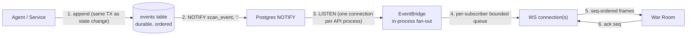

# EVENT ARCHITECTURE

**Status:** Proposed
**Decision:** Postgres as the event store **and** the transport (`LISTEN/NOTIFY`). No Redis, no Kafka.
See `ARCHITECTURE_DECISIONS.md` ADR-007.

---

## 1. The requirement that drives everything

The master prompt's hardest constraint on the War Room is:

> "The frontend must not fabricate activity when the backend is idle." (§11)

That is an *architectural* requirement, not a UI one. It holds only if:

1. Every state change produces exactly one durable event (no state mutation without an event).
2. Events are the **only** source of UI state — there is no parallel "current status" the UI polls.
3. Ordering is total per scan and gaps are detectable.
4. Replay is possible from the store, not from a memory buffer.

If any of the four fails, the UI must guess, and guessing is fabricating.

## 2. Path



**Step 1 is the important one.** The event append happens inside the same database transaction as the
state change it describes. Either both are durable or neither is. `NOTIFY` is deliberately sent after
commit (Postgres queues notifications transactionally and delivers on commit), so a subscriber can
never see an event for a rolled-back transition.

## 3. Event envelope

```jsonc
{
  "id": "evt_01J8…",
  "scan_id": "scn_01J8…",
  "seq": 208,
  "type": "observation_created",
  "at": "2026-11-12T09:21:44.183Z",
  "actor": "SPECTRE",
  "payload": { … },
  "causation_id": "dec_01J8…",   // the decision that caused this
  "correlation_id": "hyp_01J8…"  // the hypothesis thread this belongs to
}
```

`causation_id` and `correlation_id` are what make the event log an *explanation* rather than a
transcript. Without them the feed is a wall of noise; with them the UI can render "because of →" links
and filter to a single hypothesis thread. This is the cheapest large win in the whole design.

## 4. Event catalogue

| Type | Payload (key fields) | UI surface |
|---|---|---|
| `investigation_started` | `objective, intensity, budget` | feed header, budget meter |
| `investigation_updated` | `from, to, reason` | state chip |
| `investigation_completed` | `stop_reason, counts` | terminal banner |
| `agent_activated` | `agent, role, objective` | agent network |
| `agent_assigned` | `agent, action, target` | agent card |
| `agent_status` | `agent, status, detail` | agent card |
| `agent_error` | `agent, action, error_class, message` | feed (warning), agent card |
| `hypothesis_created` | `hypothesis_id, claim, maswe, required_evidence` | hypotheses panel |
| `hypothesis_updated` | `hypothesis_id, status, satisfied_evidence` | hypotheses panel |
| `decision_made` | `decision_id, action, target, alternatives, expected_outcome` | decision log |
| `tool_requested` | `tool, action, target` | tool panel |
| `tool_started` | `tool, argv_redacted, version` | tool panel |
| `tool_completed` | `tool, status, duration_ms, evidence_id` | tool panel, feed |
| `tool_unavailable` | `tool, reason` | capability banner |
| `observation_created` | `observation_id, kind, subject, statement, maswe` | feed, graph |
| `evidence_collected` | `evidence_id, kind, sha256, byte_size` | evidence vault |
| `validation_started` | `finding_id, gate` | validation panel |
| `finding_created` | `finding_id, title, severity, confidence` | findings list |
| `finding_confirmed` | `finding_id, verdict_id, gate_evidence` | findings list (accent) |
| `finding_rejected` | `finding_id, verdict_id, rejection_reason` | findings (muted, retained) |
| `approval_requested` | `approval_id, action, intensity_required, risk_summary` | approval banner |
| `approval_granted` / `approval_rejected` | `approval_id, by, at` | banner |
| `graph_delta` | `nodes[], edges[]` | graph animation |
| `planner_rejected` | `proposed_action, reason` | diagnostics (hidden by default) |
| `report_ready` | `report_id, version, coverage` | report tab |
| `budget_warning` | `resource, used, limit` | budget meter |
| `scan_cancelled` | `by, at` | terminal banner |

**Rule:** an event type exists only if a UI surface consumes it. Event types with no consumer are
schema debt. The table above is therefore also the UI contract, and it should be trimmed rather than
grown.

## 5. Ordering, durability, replay

| Property | Mechanism |
|---|---|
| Total order per scan | `seq` allocated under the investigation row lock; `UNIQUE(investigation_id, seq)` |
| Durability | append inside the same TX as the state change |
| Replay from arbitrary point | `SELECT … WHERE investigation_id=$1 AND seq > $2 ORDER BY seq LIMIT n` |
| Gap detection | client compares expected vs received `seq`; renders an explicit gap marker |
| Reconnect | client passes `after=last_seq`; server replays then goes live |
| At-least-once to subscribers | `NOTIFY` may be coalesced (payload limit 8000 bytes) → subscribers re-read from the table, so a dropped notification degrades to a poll, never to data loss |

That last row is the subtle correctness point. `NOTIFY` payloads are limited to 8000 bytes and
notifications can be coalesced under load, so **the notification is only a wake-up hint, never the
data**. The bridge reads the missing rows from `events`. This makes the system correct under
notification loss, which is precisely the class of bug that produces a War Room that silently stops
updating.

## 6. Why not the proposed Redis layer

The master prompt proposes `Agent → Emitter → Event Store → Redis → WebSocket → UI`. Analysis:

| Option | Durability | Extra service | Replay | Verdict |
|---|---|---|---|---|
| In-memory asyncio only | none | no | no | fails requirement |
| Redis pub/sub (proposed) | none in Redis itself | **yes** | only via the store | redundant hop |
| Redis Streams | yes (bounded) | yes | yes | duplicate of Postgres |
| Kafka | yes | yes, heavy | yes | grossly over-provisioned |
| **Postgres table + LISTEN/NOTIFY** | yes | **no** (already have it) | yes | **chosen** |
| Server-Sent Events instead of WS | yes | no | yes (via Last-Event-ID) | viable alternative, see below |

Throughput reality: a scan emits tens of events per second at most. Postgres handles thousands of
`NOTIFY`/second. There is no performance argument for Redis here, and adding it creates a second
source of truth for "what happened" — the exact failure mode this architecture is built to avoid.

**SSE vs WebSocket:** SSE gives server→client streaming with automatic reconnect and `Last-Event-ID`
replay *for free*, which is 90% of what the War Room needs. WebSocket is chosen only because the
"ask NEXUS" interaction and future bidirectional features benefit from one channel. If the team is
short on time, **SSE is the better engineering choice** and the API can expose both. Recorded as an
open decision (ADR-007 note).

## 7. Pause / resume / cancel semantics

| Action | Effect on events |
|---|---|
| Pause | FSM enters `PAUSED` (a sub-state of `SELECTING`); the worker stops leasing frontier entries; in-flight tool calls are **allowed to finish** and their events are recorded |
| Resume | lease loop restarts; frontier state untouched |
| Cancel | `CANCELLED`; runner receives SIGTERM to the tool process group; partial output is preserved as evidence with `truncated=true` |
| Emergency stop | all scans → `CANCELLED`; all leases released; tool leases revoked |

Killing a tool mid-write must not leave a half-parsed artifact that later looks authoritative. Hence
`truncated` on evidence and `killed` as a distinct `tool_executions.status`.

## 8. Anti-fabrication controls (how requirement §11 is *tested*)

1. **Event-coverage test:** every repository method that changes investigation-visible state asserts
   that an event was appended in the same TX. A state change without an event fails CI (NFR-AUD-1).
2. **Frontend purity test:** ESLint rule forbids `setTimeout`/`setInterval` inside the feed and agent
   components, and forbids importing from a `mock/` directory in production code. A feed that advances
   itself is the specific bug being prevented.
3. **Idle test:** with no events for 10 s, a Playwright run asserts the DOM does not change.
4. **Replay equality test:** client event log after a forced disconnect equals server log (§AC-FR-WAR-2).

## 9. Retention and growth

Events are small (≈ 0.5–2 KB). 2 000 events/scan × 1 000 scans ≈ 2 GB. Retain permanently — they are
the audit trail. If it ever matters, partition `events` by `created_at` month. Do not prune: pruning
the audit trail to save disk on a graduation project would be the wrong trade.

## 10. Open questions

| # | Question |
|---|---|
| Q1 | WebSocket or SSE for v1? (Recommendation: SSE if time-constrained.) |
| Q2 | Should `planner_rejected` events be visible by default? They are the most honest diagnostic and the most confusing to a non-expert viewer. |
| Q3 | Do we need `graph_delta` events, or is a debounced `GET /attack-graph` after any graph-affecting event sufficient? (Recommendation: debounce — deltas double the graph code for marginal animation gain.) |
