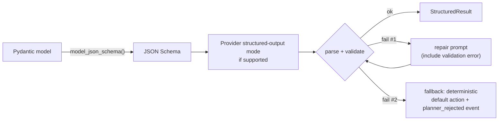

# MODEL ROUTING & PROVIDER ABSTRACTION

**Status:** Partially implemented — see `LOCAL_MODEL_PROVIDER.md`
**Principle:** one interface, two implementations, two tiers. No claim about which model is "best"
until `MODEL_BENCHMARKS.md` has produced numbers — this document contains **no rankings**.

---

## 1. The interface

```python
# mobius/core/ports.py   <- Layer 1. Protocols only: no implementation, no vendor SDK, no I/O.
class ModelGateway(Protocol):
    async def complete_structured(
        self,
        *,
        role: ModelRole,
        system: str,
        user: str,
        schema: type[BaseModel],
        temperature: float = 0.0,
        max_tokens: int = 4096,
        budget: BudgetMeter,
    ) -> StructuredResult: ...

class StructuredResult(BaseModel):
    data: BaseModel
    raw_text: str
    model_id: str
    prompt_version: str          # hash of the prompt template
    input_tokens: int
    output_tokens: int
    latency_ms: int
    repair_attempts: int
    schema_valid: bool
```

> **Why this port lives in `core/`, not `adapters/`.** `ARCHITECTURE.md §3.1` forbids Layer 1 from
> importing Layer 2, and enforces it with an import-lint test. `AgentContext` — a Layer-1 contract —
> exposes `model: ModelGateway`, so the Protocol must be declared in `mobius/core/ports.py` alongside
> `EvidenceReader`, `ToolInvoker`, `EventEmitter` and `BudgetMeter`. Adapters *implement* these ports;
> core never imports from `adapters/`. An earlier draft placed `ModelGateway` under `adapters/llm/`,
> which would have inverted the dependency on day one.

Deliberately absent from the interface: streaming, tool-calling, vision, function schemas, agent
frameworks. Each of those is a capability that must be *measured* before it is *relied on*, and adding
them to the interface before measuring is how a project ends up coupled to one vendor's semantics.

## 2. Model roles (two tiers, not one per agent)

The master prompt suggests per-agent model assignment. That is the right end state and the wrong
starting point: evaluating 8 agents × N models requires a harness, a corpus and time that a graduation
project does not have. Two tiers capture ~90% of the benefit at ~10% of the evaluation cost.

| Tier | Used by | Why this tier exists | Config key |
|---|---|---|---|
| `reasoning` | NEXUS (planning), VERITAS (validation), report synthesis | These tasks need judgement under uncertainty and are wrong 20% of the time in ways that matter | `MOBIUS_MODEL_REASONING` |
| `workhorse` | SPECTRE, PHANTOM interpretation, VECTOR interpretation | High volume, narrower task, well-specified output | `MOBIUS_MODEL_WORKHORSE` |
| `none` | RECON, ARCHIVIST | Deterministic parsing and formatting. **Using a model here would add cost and hallucination risk for zero benefit.** | — |

### 2.1 VERITAS must not use the producer's model

If SPECTRE and VERITAS are the same model at the same temperature, VERITAS tends to *agree with
SPECTRE's framing* — the errors are correlated. Assigning VERITAS the `reasoning` tier while SPECTRE
runs on `workhorse` gives real (if partial) independence. The system should assert
`model(VERITAS) != model(SPECTRE)` at startup and refuse to run otherwise, unless an explicit
`--allow-self-review` flag is set for experimentation.

This is the cheapest available substitute for a second human reviewer, and it is worth stating in the
report as a methodological control rather than a convenience.

## 3. Structured output enforcement

Reliability of structured output is the single most important practical property. The pipeline:



Rules:

1. The schema is **generated from Pydantic**, never hand-written — hand-written schemas drift from the
   models that validate them.
2. Enums are used aggressively (`verdict`, `fidelity`, `assertion`, `action`). A free-text field that
   *should* be an enum is where hallucination enters.
3. `"insufficient_evidence"` is a valid value in every output where it applies. A model with no legal
   way to say "I don't know" will guess.
4. Two repair attempts maximum, then a deterministic fallback. **Never** loop on repair: an infinite
   repair loop is the LLM version of an infinite retry storm.
5. Validation failures are events (`planner_rejected`), so schema instability is observable rather
   than silent.

## 4. Prompt versioning

Prompt templates live in `mobius/agents/prompts/<agent>/<name>.md`, are hashed at load, and the hash
is stored on every `Decision` and `Verdict`. Consequence: changing a prompt does not silently
invalidate past findings — you can always tell which prompt produced which conclusion. Without this,
"the tool used to say X" is unfalsifiable.

## 5. Cost and budget control

| Control | Mechanism |
|---|---|
| Per-scan token budget | `BudgetMeter` decremented on every call; `BudgetExceeded` raised, not caught |
| Per-agent budget | `AgentBudget` in the agent spec |
| Prompt size cap | Untrusted content truncated with an explicit `«TRUNCATED»` marker, never silently |
| Context strategy | Agents receive **evidence summaries + IDs**, not full file contents. They call a tool to fetch a slice. This is the difference between a 4 k-token prompt and a 100 k-token one |
| Caching | Identical (prompt_hash, input_hash, model) → cached; safe because temperature is 0 for analysis roles |

The context strategy deserves emphasis: a naive implementation pastes the whole decompiled class into
the prompt. On a large app that is neither affordable nor accurate (long contexts degrade instruction
following). Fetch-by-reference keeps prompts small and makes the evidence chain explicit, since the
model must name the ID it read.

## 6. Provider isolation

| Requirement | Implementation |
|---|---|
| No vendor SDK in Layer 1 | `ModelGateway` is a Protocol; Layer 1 imports nothing vendor-specific |
| Two implementations to prove the abstraction | one hosted-API provider + one open-weight provider served locally (Ollama/vLLM) — the second also proves the **offline** path, which matters if the lab has no internet during a demo |
| Model swap without code change | env/config only |
| Failure isolation | provider error → `agent_error` event + retry with backoff (max 3) → frontier adapts |
| Key handling | env-only; never logged; never in a prompt |

**Local execution feasibility.** An open-weight model on a laptop is plausible for the `workhorse`
tier at low quality and implausible for `reasoning` at acceptable latency on 8–16 GB RAM. This must be
measured (§`MODEL_BENCHMARKS.md`), not assumed in either direction. The offline path is valuable for
demos regardless of quality ranking.

## 7. What is explicitly not being built

| Not built | Reason |
|---|---|
| Automatic model selection based on task embeddings | No evidence it outperforms a static two-tier map at this scale |
| Fine-tuning | No labelled corpus; the corpus in `MODEL_BENCHMARKS.md` is ~120 items, far too small |
| A routing policy that learns from outcomes | Would need hundreds of completed scans; deferred |
| Multi-model voting / ensemble per decision | Triples cost for an unmeasured accuracy gain; a candidate for v2 if benchmarks justify it |
| Agent framework (LangChain/LangGraph/CrewAI) | The state model and audit trail are the core IP; delegating them to a framework cedes the parts that must be inspected. Direct API calls are ~200 lines |

## 8. Implemented provider baseline

PR #33 adds a standard-library Ollama adapter and a deterministic mock provider behind the structured model contract. The core `ModelGateway` port in `mobius/core/ports.py` is implemented by the local structured gateway. Provider use is disabled by default, local endpoint validation is enforced, Pydantic JSON Schema is sent to Ollama and validated again locally, and per-investigation consent plus reported token usage are required.

This is only the provider boundary. No current agent invokes it, no prompt version is persisted yet, no repair/retry loop or cache exists, and no model benchmark has been run. Those remain explicit follow-up work.

## 9. Open questions

| # | Question |
|---|---|
| Q1 | Does the chosen provider support strict JSON-schema constrained decoding? (Changes the reliability profile substantially.) |
| Q2 | Is an offline demo required? (Decides whether the second provider is a hard requirement or a nice-to-have.) |
| Q3 | Budget in dollars or tokens? (Tokens are predictable; dollars are what a panel asks about. Track both.) |
| Q4 | Should `--allow-self-review` exist at all, even for experiments? (Recommendation: yes, but it must stamp the verdict as `self_review=true` so it can never be mistaken for independent.) |
